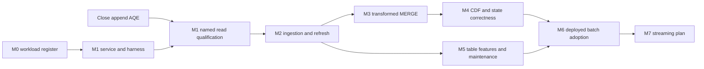

<!--
 Licensed to the Apache Software Foundation (ASF) under one or more
 contributor license agreements. See the NOTICE file distributed with
 this work for additional information regarding copyright ownership.
 The ASF licenses this file to You under the Apache License, Version 2.0
 (the "License"); you may not use this file except in compliance with
 the License. You may obtain a copy of the License at

 http://www.apache.org/licenses/LICENSE-2.0

 Unless required by applicable law or agreed to in writing, software
 distributed under the License is distributed on an "AS IS" BASIS,
 WITHOUT WARRANTIES OR CONDITIONS OF ANY KIND, either express or implied.
 See the License for the specific language governing permissions and
 limitations under the License.
-->

# Spark Hub Governed Delta Adoption Roadmap

> **For agentic workers:** REQUIRED SUB-SKILL: Use superpowers:subagent-driven-development to execute each reviewed milestone plan task-by-task. This is a dependency roadmap, not authorization to implement every milestone simultaneously.

**Goal:** Cover actual Spark Hub operations through Gravitino-owned Delta registration and Ranger policies, then retire Glue for migrated datasets.

**Architecture:** Extend native Delta integration where the real workload requires it; migrate the shared Spark Hub catalog/read/write/state services. Keep Spark/Delta native execution and Ranger policy semantics. Each milestone has an observable deliverable and independent acceptance.

**Tech Stack:** Spark 3.5.4/3.5.6, Delta 3.3.0/3.3.2, Java 17, Scala 2.12.21, Ranger server/client 2.8.0, classic PySpark, S3/MinIO.

**Spec:** [Adoption design](../specs/2026-10-29-spark-hub-adoption-design.md).

Status: M0/M1 and append AQE are independently reviewed, closed and pushed. Adoption closure is Gravitino `c7681d08a0f8a562375e20bc6517c8c6d6c6da45` and Spark Hub `d01024b6f459ad2743b7b55099226b8c3dc742fd`; append closure is `90a0e1c65db133ecdbff8a2758c71a4b749c58f1`. The four original six-case read cells qualify only the bounded read profile. Next is the [M2 first-task plan](2026-10-30-spark-hub-write-foundation.md); later milestones remain design-gated. Historical dependency instructions below describe sequencing, not pending predecessor work.

## Global Constraints

The design's Global Constraints bind every milestone verbatim. No core/API/server/client/storage-schema change, engine fork, raw-path governance fallback, silent policy weakening or silent removal of platform options. Existing append-AQE validation closes separately. Catalog-demo is not an adoption gate or a replacement for Spark Hub acceptance.

## Review Focus

1. Named routing accidentally falls back to raw S3 or Glue on authorization failure — M1 negative tests and M6 cutover tests.
2. Materialization/joins/windows discard original source authority — M3 source-family, policy refresh and checkpoint ownership tests.
3. Source advances or is replaced between read and state publication — M4 captured-end/native-identity/replay tests.
4. Mask collisions or visibility changes silently produce an incorrect replica — M4 output-mode and current-policy reconciliation tests.
5. A postcommit maintenance/observation failure triggers duplicate mutation or premature checkpoint — M2/M4/M5 fault-injection and M6 restart tests.

## Sequence

Independent catalog-service code, test harness preparation and pure Python checks may proceed during append qualification. Integrate the reviewed append closure while preserving audited commit ancestry before JVM checks, native runtime packaging and live qualification. The frozen append worktree remains isolated. M5's feature requirements are captured in M0 even though its implementation follows the write foundation. M3 and M4 jointly qualify incremental pipelines.

| Milestone | Concrete work and primary ownership | Closure evidence |
| --- | --- | --- |
| **M0 — Workload acceptance register** | Pin actual Spark Hub revision and callers. Classify supported, adaptation-needed, connector-gap and unqualified cases. Include legacy v1 and shared v2 paths, optional vs actively called maintenance, expected options/defaults and policy profiles. | Machine-readable case register, source bindings and checker tests. No runtime coverage claim from a static inventory. |
| **M1 — Named read foundation** | Spark Hub optional runtime profile, explicit UUID/name bindings, shared read-only catalog service and native PySpark probe. Use existing PUBLISHED registrations; no production backend switch. | Actual masks/filters, column denial, missing binding and fresh-action revoke on all pinned pairs; no raw-path/Glue access. Read-only scope remains explicit. |
| **M2 — Ingestion, lifecycle and ordinary writes** | Connector/provider native create/publish and safe retry lifecycle; Spark Hub common sink routes authorized named operations. Admit required external-input categories. Support actual APPEND options, initial load, OVERWRITE/full refresh and schema evolution with registration consistency. Handle userMetadata and the platform's effective autoMerge/autoCompact settings explicitly. | Actual JDBC/file/constructed-source ingestion, create/append/refresh, schema changes, duplicate retry, denial and postcommit fault cases through `write_dataset`. Fixed-schema success cannot close schema-evolving cases. |
| **M3 — Real DataFrame composition and MERGE** | Extend logical source integration for required snapshots, multiple governed sources, joins/unions, dedup windows/aggregates, expressions/UDFs and materialization. Preserve original permissions through checkpoints. Add snapshot NOT MATCHED BY SOURCE semantics and qualified schema evolution. Adapt the shared sink to the named facade. | Representative Select/Transform/Union/Join v4 and snapshot merge call paths, including eager localCheckpoint and actual options. Source/target denial, masks, copied/expired contexts and native ambiguity/commit outcomes pass. No local-row reconstruction workaround. |
| **M4 — CDF consumer and durable state** | Named authorized head/history/identity surface; explicit per-source captured bounds; correct bootstrap/gap/rebootstrap. Persist exact processed ends and native identity. Define delete/preimage, policy-change and masked-key behavior by output mode. Qualify state writes and sink/state crash recovery. | Initial load plus multiple updates/deletes, visibility entry/exit, mask collisions, empty filtered interval, source advance/replacement, missing history, sink-committed/state-failed recovery. State never advances past processed input. |
| **M5 — Features and maintenance** | Generated YEAR/MONTH/DAY partition columns; defaults/protocol profiles actually used; auto-compaction/optimized writes; retention ALTER, scheduled VACUUM and manifest behavior during migration. Decide which Glue-specific artifacts cease to be required after consumer migration. | Real generated-partition pipelines and FULL_SCHEDULED paths pass with current policies, feature metadata and native actions checked. Maintenance denial/failure is visible and cannot misreport rollback or advance consumer state. Optional unused OPTIMIZE/DELETE remains separately listed until required. |
| **M6 — Deployed batch adoption and Glue retirement** | Pin artifacts and runtime settings; qualify distributed workers, application identity, session reuse/background threads, journals and restarts. Establish one owner per dataset and reconcile existing native identities/schema before migration. Move shared production routes only after dependencies pass. | Actual representative Spark Hub jobs on the deployed execution profile; reads/writes/restarts/policies/state all pass. Concrete dataset manifest and cutover/recovery procedure reviewed before external migration. No dual writes for comparison; use separate fixture targets or read-only comparison. |
| **M7 — Structured Streaming** | Separate design/plan for native writeStream, trigger-once behavior, checkpoint/offset identity, policy refresh, schema changes and the Bronze-to-target batch tail. | Restart/replay/offset and authorization cases through the real streaming entry points. Batch append success does not qualify streaming. |

## Immediate steps

- [x] Finish the existing append-AQE matrix and reviews, then push that reviewed milestone under standing authorization.
- [x] Review this proposed design/roadmap and M0/M1 task plan as one concrete planning package.
- [x] Start M0/M1 with the existing subagent-driven execution method; use isolated worktrees for both repositories and retain their current user changes.
- [ ] At each later milestone boundary, write its exact source-level plan from the accepted contract and predecessor evidence; do not open all implementations at once.
- [ ] Keep a single coverage register so completed capabilities, unresolved gaps and rejected/unqualified cases remain visible without rerunning unrelated evidence.

## Reporting and scope control

Report progress by completed workload/capability and original evidence, not total tests alone. Every milestone report identifies API/config/source/schema/policy/deployment limits. Distinguish test-authored fixtures from public grant propagation. Record original failures and known committed state.

No completion dates are asserted before the native integration milestones are scoped. Full batch adoption depends on M2–M6; streaming and wider Delta feature parity remain separate completion claims. The critical next outcome after the read foundation is a real shared-sink ingestion/refresh path, not another isolated demo.
