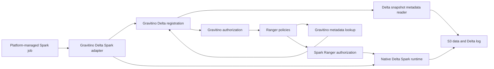

# Delta through Spark: design baseline

Status: requirements confirmed; architecture proposed for implementation planning.
The native catalog bridge and registration transaction protocol require the
feasibility gate below before production implementation is specified in detail.
No runtime support is claimed by this document.

## Confirmed requirements

| ID | Requirement |
| --- | --- |
| R1 | Support Spark 3.5.4 and 3.5.6 with Delta 3.3.0 and 3.3.2. Validate all four combinations as the planning assumption. |
| R2 | Gravitino owns registration and named-table resolution. Remove the target runtime dependency on Glue; do not substitute an independent Hive metastore. |
| R3 | Provide the Spark catalog experience available for Iceberg, including named catalogs coexisting in one Spark application. Preserve native Delta semantics. |
| R4 | Fully support the selected Delta releases through Spark. Registration-only or read-only integration does not satisfy the objective. |
| R5 | Gravitino authors and pushes its existing supported grants and revocations into Ranger. Its privilege model is unchanged. |
| R6 | Ranger owns column permissions, row filters, and masks using Gravitino metadata; Spark enforces them. Gravitino access-policy changes preserve Ranger-owned policies. |
| R7 | Use S3 in the first release. Keep registration independent of AWS catalog services and storage-specific integration separate for future clouds. |
| R8 | The platform prevents concurrent writer jobs for the same dataset. Preserve that invariant for DDL, maintenance, streaming, retries, and recovery. |
| R9 | Do not modify Gravitino core. Use existing public APIs and extension interfaces; preserve core storage, privilege definitions, server REST contracts, and client contracts. |

Planning defaults, not additional user requirements: use the repository's Scala
2.12 baseline, classic Spark SQL and Scala/Python DataFrame/Delta APIs, and the
existing Kyuubi 1.10.2 authorization dependency as the initial compatibility
baseline. Verify the deployed Scala binary version, Spark entry points, identity
propagation, and S3 credential mechanism before production packaging. Spark
Connect is not inferred from a request targeting Delta 3.3.x.

## Architecture and ownership

Recommend a dedicated `lakehouse-delta` server provider backed by Gravitino's
entity store, with a Spark 3.5 adapter that preserves native Delta execution.
Reuse `ManagedTableOperations`, generic catalog location resolution, and Lance's
schema-refresh pattern where their contracts fit. The existing generic Delta
registration path remains an alternative in the feasibility comparison.

The diagram shows logical responsibilities, not implemented call ordering.
Authorization must finish before an operation reads protected data or commits a
mutation. Gravitino metadata loading must not require table-wide read permission
in a way that defeats a valid column-only grant.

Gravitino owns catalog/schema names, table identity and location, ownership, and
grants. The Delta log owns committed schema, partitioning, Delta properties,
protocol features, history, and data-file state. Gravitino exposes a version-aware
projection of native metadata; it must not maintain a divergent authoritative
schema. Refresh must preserve object/column policy identity or explicitly handle
identity changes.

Delta Spark owns execution and commits. Server metadata reads must not create
another writer. Any server-initiated log mutation must participate in the
platform's existing exclusion contract; the implementation must not add an
uncoordinated writer behind catalog DDL.

Implement registration lifecycle within the catalog provider and Spark adapter
using existing extension contracts. New modules and their build/distribution
wiring are allowed; edits to `core/`, public privilege definitions, storage schema,
server REST contracts, and client contracts are outside scope. Reuse shared code
through its existing interfaces. Policy coexistence behavior belongs in a
dedicated authorization extension rather than a change to shared core behavior.

## Catalog decision

| Choice | Decision |
| --- | --- |
| Dedicated Delta provider | Recommended for independent lifecycle, properties, capabilities, and packaging. Must reuse shared infrastructure and pass the native bridge gate. |
| Extend generic lakehouse | Viable fallback if the same native bridge and lifecycle contract fit its format delegation without duplicating metadata authority. Compare using the same tests. |
| Glue/Hive-backed registration | Rejected as the target because Gravitino must own registration. Native session catalogs may be used only as experimental controls. |

Delta 3.3.0 and 3.3.2 have identical `DeltaCatalog` source in the inspected class.
Creation consults Spark's session catalog and restricts a delegate callback to
Unity Catalog; native type checks and staged commands also matter. Do not assume
the Iceberg adapter can simply be renamed. No Unity package impersonation,
test-only switches, metadata mirroring into Glue/Hive, or conversion to Iceberg
is an acceptable solution.

## Required feasibility decisions

The first implementation work is a disposable contract experiment. Its output
must include passing/failing SQL and API cases, actual runtime artifacts, and a
decision record covering these questions:

1. Can an unmodified target Delta runtime create, CTAS, replace, alter, and merge
   through two independent Gravitino catalogs without a second registry?
2. Which native table representations and planner hooks are required? If a Delta
   dependency patch is unavoidable, show the smallest patch and compatibility
   implications before making it a production dependency.
3. How are registrations reserved, exposed, finalized, and recovered around a
   Delta commit using existing APIs and provider extension points? Specify
   idempotency keys, state transitions, authorization before commit, and crash
   behavior. Never advertise a successful native creation when only registration
   succeeded. An approach requiring core changes fails the current design gate.
4. Which canonical resource identity can Ranger and Spark both use? The existing
   HadoopSQL translator removes catalog names. Verify catalog-aware resource
   naming or service routing with duplicate schema/table names before choosing.
5. Can Ranger-owned column grants, masks, and filters survive native Delta plan
   rewriting and existing Gravitino metadata checks? Establish a metadata access
   path without changing Gravitino's privilege model or broadening the user's
   Ranger data access.

A failed experiment changes the implementation design, not the requirements.
An external-table-only adapter is not a passing substitute.

## Authorization contract

Reuse the role/grant callback mechanism and Ranger Admin client through existing
interfaces. Keep Gravitino's privilege definitions, bindings, serialization, and
validation unchanged. Column grants and their revocations are authored directly
in Ranger, alongside masks and filters; they are not round-tripped through
Gravitino's role/grant API.

`Privileges.SelectTable.canBindTo` excludes `COLUMN`. That limitation is an
integration constraint, not a core feature to add. Establish metadata loading
with existing permissions. If a trusted metadata service identity is required,
use existing authentication and keep it separate from the authenticated end-user
identity sent to Ranger. Do not grant the end user table-wide `SELECT` simply to
make metadata loading succeed. Do not forward the metadata service identity as
the query subject or use it to authorize data access.

Access policy selection must identify both policy type and Gravitino ownership.
Ordinary Gravitino grant/revoke changes cannot select, delete, or overwrite
Ranger-owned column access, mask, or filter policies. Implement ownership-aware
selection in a Delta authorization provider through the existing
`AuthorizationProvider`/`AuthorizationPlugin` extension contracts. Do not change
the shared privilege model or rely on the current single-policy assumption.
Rename, column evolution, drop, and recreate need explicit resource-identity
behavior and coexistence tests.

Ranger resource lookup must fetch catalogs, schemas, tables, and columns from
Gravitino with a scoped service identity. Paginate and bound requests; report
authentication failures and backend outages rather than returning misleading
empty results. Policy publication alone is not metadata discovery.

Table reads, column-only reads, writes, source/target relations in merge,
historical reads, streams, and maintenance must produce the expected Ranger
resources and actions. Raw path access must not silently bypass a registered
table's policies. Cached results, checkpoint restarts, and active-stream
revocation require measured behavior and an explicit enforcement boundary before
release. Do not claim instantaneous revocation from policy polling alone.

### Task 0.3 concrete local candidate and deployment boundary

The test-only candidate uses one Ranger service with
`catalog -> database -> table -> column`. Access and mask requests carry all four
keys; row-filter requests stop at the table level. The native descriptor is a
non-persisted Spark `CatalogTable` whose `TableIdentifier` has separate table,
database, and catalog fields. `IdentityDeltaCatalog.loadTable(Identifier)` calls
the existing named bridge, retains `DeltaTableV2`, and copies only its descriptor.
No three-part `tableIdentifier` string or session-catalog registration is used.
Native read and analyzed `MergeIntoCommand` source/target identity are separate
checks; MERGE identity does not establish MERGE authorization.

The policy selector prototype subclasses `RangerAuthorizationHadoopSQLPlugin` and
runs inherited `onRoleUpdated` grant/revoke mechanics. It changes resource
translation/creation and wildcard lookup in test code only. Managed policies must
be access type 0, belong to the configured service, carry `gravitino-managed`,
`gravitino-metalake-id:<id>`, and `gravitino-catalog-id:<id>`, and have the exact
resource key/value shape. Duplicate owned access policies fail closed. Unlabelled
Ranger access policies and mask/filter policies remain Ranger-owned. No stable
table ID is available in the existing callbacks; drop/recreate attachment remains
an explicit Ranger administrator contract.

`CatalogAwareRangerExtension` is a bounded test read rule installed through
`SparkSessionExtensions.injectResolutionRule`. It obtains decisions from the real
Kyuubi `SparkRangerAdminPlugin` (1.10.2) / Ranger engine, and parses the
returned mask/filter expressions into Spark plans. It distinguishes native
`TahoeLogFileIndex` data scans from `DeltaLogFileIndex` transaction-log metadata
reconstruction. That metadata allowance is necessary for native execution and is
not evidence of metadata confidentiality, storage credential separation, or
permission to run arbitrary jobs. The fixture's fresh read plans and direct Delta
path negative do not establish safety for cached/reused plans, arbitrary file
APIs, user-constructed plans, time travel, streaming, DML, or maintenance.

`NamedDeltaCatalog.createMetadataClient(String)` is a test helper seam, not a core
or client contract addition. Its identity-decorating subclass uses the existing
`GravitinoAdminClient.builder(uri).withSimpleAuth("metadata_service")` interface;
query evaluation remains under local `UGI.doAs("reader")`. No broad reader grant
is added. The embedded server does not validate the production metadata
permission/authentication boundary. Production must provision a scoped metadata
credential with existing USE_CATALOG/USE_SCHEMA/SELECT_TABLE permissions and an
independently authenticated query subject, with rejection of missing/tampered
session signatures or an equivalent trusted launcher. The SQL-only versus
arbitrary-job platform trust contract remains open.

Ranger Admin installation of this service definition, resource lookup,
persistence/labels, polling/cache behavior, and cross-process revocation remain
external acceptance gates. Local JSON is supplied through
`ranger.plugin.spark.policy.source.impl`; `refreshPoliciesAndTags()` exercises a
local snapshot refresh only. The production provider is not registered or
packaged by this experiment. Task 0.2's managed lifecycle/provider/recovery
failures remain full-support blockers; see the results document for measured
Task 0.3 outcomes and dependency convergence.

Ranger 2.8.0 is the required implementation and packaging target. Task 0.4
executes this same bounded candidate on 2.8.0 across all four Spark/Delta pairs,
with loaded-jar assertions and dependency convergence for every Ranger module.
The earlier Ranger 2.5.0 Spark and Ranger 2.4.0 mocked Admin runs remain
historical characterization only. Ranger 2.8 splits executable audit code into
`ranger-audit-core`; production packaging must select and validate any actual
audit destination separately.

## S3 and migration

Use the standard single-driver S3 LogStore under the platform exclusion
guarantee. No DynamoDB coordinator is required by the confirmed topology. Match
the Hadoop AWS connector to the resolved Spark Hadoop runtime; test driver and
executor credentials, expiry/refresh where applicable, sequential job handoff,
and failure recovery on actual S3. Local files or S3 emulation cannot prove S3
commit behavior.

Registration remains cloud-independent. Use workload IAM or Gravitino-vended
credentials according to the deployment's existing identity mechanism; do not
copy Iceberg FileIO configuration into Delta's Hadoop configuration and assume
equivalent behavior.

Demonstrate replacing Glue registrations with Gravitino registrations at existing
locations. Validate against Delta logs and preserve data/history. Import tooling,
cutover automation, and production Glue deletion need separate concrete scope;
the plan includes a migration rehearsal and runbook, not destructive production
actions.

## Acceptance and evidence

All four runtime pairs must pass catalog discovery, creation/registration, CTAS,
replace, alter/rename/drop, SQL and DataFrame reads/writes, append/overwrite,
merge/update/delete, schema evolution, time travel/history/restore, change data
feed, streaming/restart, and maintenance cases available in the pinned releases.
Inventory their table features from pinned source and documentation, including
column mapping, deletion vectors, constraints/defaults, generated/identity
columns where supported, clustering, type widening, row tracking, feature
upgrades/downgrades, and UniForm where applicable. Record native behavior first;
match it through the integration without silently skipping unsupported cases.

For each case, record runtime versions, entry point, table features, expected
native result, integrated result, authorization subjects/actions, Delta versions
before/after, and any denied-operation side effects. Version-specific absence
must be backed by native evidence, not classified as an integration success.

Use positive and negative authorization cases, duplicate names in separate
catalogs, policy coexistence, metadata freshness, S3 credentials, and crash
recovery. Final evidence must include a deployment with Glue/Hive access absent.
Unit tests and a subset of read queries cannot prove full support.

## References

- [Repository investigation](../../delta-spark-integration-investigation.md)
- [Delivery plan](../plans/2026-09-07-delta-spark-implementation.md)
- [First executable work package](../plans/2026-09-07-delta-spark-feasibility.md)
